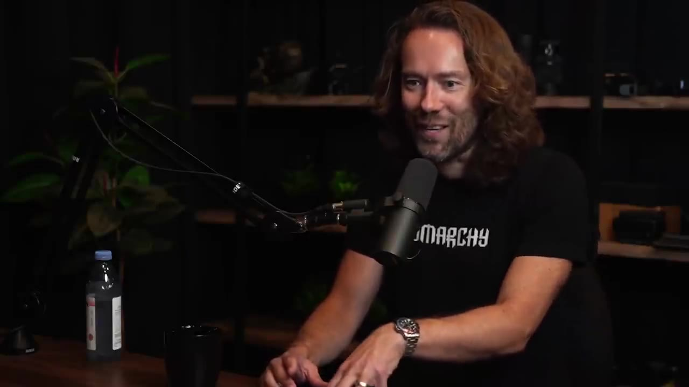
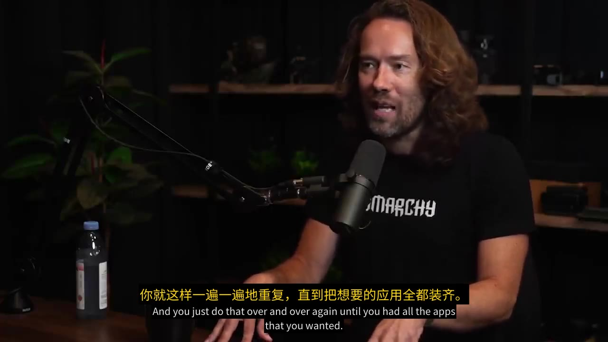

# BiliMix

BiliMix produces Chinese dubbing for English audio and video, with per-speaker voice cloning, optional background audio and bilingual ASS subtitles.

[中文](README.md)

## Workflow

Use the single `nows-ytb-dubbing` skill: input video → speaker analysis → FULL English refinement → Chinese translation → server dubbing → delivery. The current Code Agent performs both language passes. One local workflow handles uploads, validation, ASS/manifest export, task recovery and downloads. BiliMix synthesizes complete utterances and adapts video timing to the resulting audio.

By default each speaker uses a fixed qualified reference. Segment mode can condition each complete utterance on its own source audio, with audited same-speaker fallbacks. Subtitle pagination is independent of synthesis: at most two lines per language, four lines total and a text height budget of 25% of the frame.

Podcast tasks can use server-side transcription and translation. A separate TTS interface accepts reference audio and text.

## Demo

The same 60-second clip: original English on the left, Chinese dubbing on the right.

| Original | Chinese dubbing |
| --- | --- |
| [](examples/demo-original.mp4) | [](examples/demo-dubbed.mp4) |

Speech is synthesized with each speaker's cloned voice, the picture is retimed to the Chinese audio, and bilingual subtitles are burned in. More samples: [examples](https://github.com/nowszhao/BiliMix/tree/main/examples).

## Client

Python 3.10+ is required. Clients use the lightweight SDK; local URL downloads additionally require yt-dlp and FFmpeg.

```text
python -m pip install ./sdk
python scripts/install_skills.py --destination <agent-skills-directory>
python -m bilimix_cli --server <server-url> auth status
```

Use `--update` to replace installed skills with current files and retire the two superseded BiliMix workflows. Any Code Agent able to read files and execute commands can read the installed SKILL.md files.

```text
python <skill>/scripts/workflow.py setup --workdir work
python <skill>/scripts/workflow.py run --input source.mp4 --workdir work --server <server-url>
python <skill>/scripts/workflow.py run --workdir work
```

External refined dubbing requires media, a bilingual work ASS, a manifest and completed source analysis. The server validates source hashes, speaker ownership and complete ordered word coverage.

## Server

The speech server targets Linux x86_64 with Python 3.10. It requires FFmpeg 7+ with libx264, libass and drawtext, FFprobe, CJK fonts and the WhisperX, pyannote and Confucius4-TTS model stack. Demucs separates vocals from background audio. Gated speaker models require `HF_TOKEN` and model access permission. Server translation uses Ollama; Agent-refined tasks provide their own translations.

```text
./setup.sh
conda activate bilimix
python scripts/doctor.py --scope server
python services/web_app.py 5000
```

See [installation and configuration](docs/installation.md), [dubbing contract](docs/audio-first-dubbing.md), and [SDK commands](sdk/docs/cli.md).

Module responsibilities and execution invariants are documented in [Architecture](docs/architecture.md).

## Development and release

```text
python -m pytest tests -q
python scripts/sync_skill_layout.py --check
python scripts/release.py --output dist
```

A release contains current complete sources, two skill ZIPs, the SDK wheel and checksums. Credentials, machine configuration, models, task state and development artifacts are excluded.

## License

MIT
