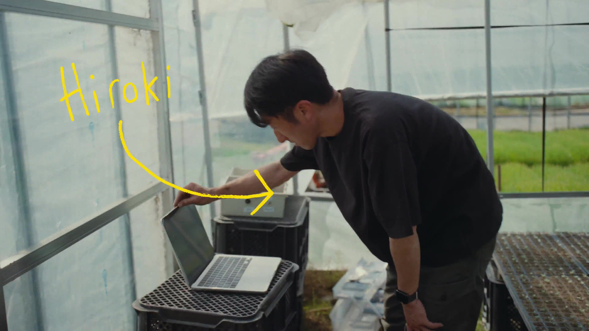
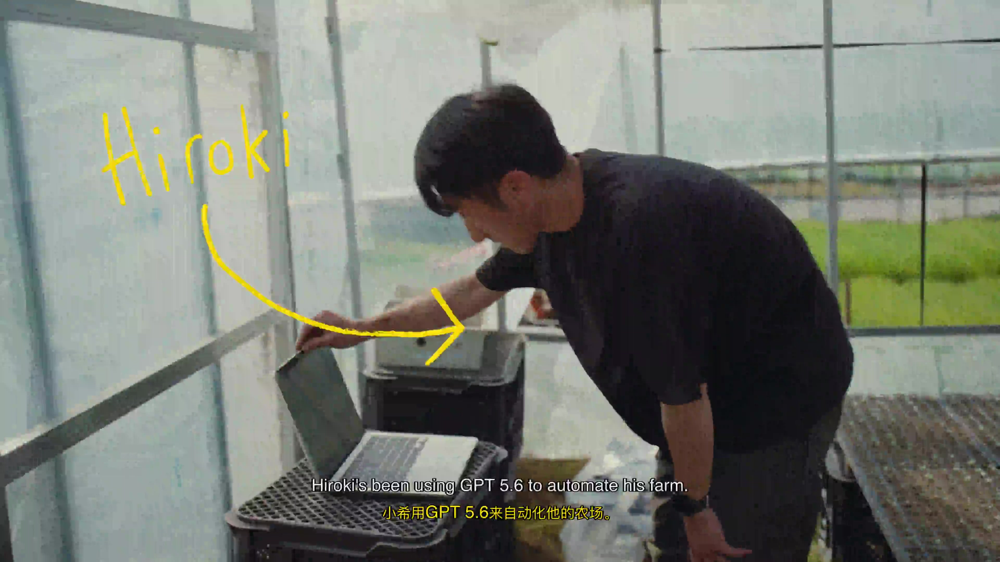

# BiliMix


Translate English audio and video sentence by sentence into Chinese and read it aloud in the original
speaker's voice — audio comes out as a Chinese-dubbed MP3, video as a dubbed MP4 with bilingual
subtitles. Transcription, translation, and synthesis all run locally; media never leaves your machine.

[中文](README.md)

## Demo

<table>
<tr><th align="center">Original</th><th align="center">Dubbed (bilingual subtitles)</th></tr>
<tr>
<td align="center" width="50%"><a href="examples/test1.mp4"></a></td>
<td align="center" width="50%"><a href="examples/test1_mixed.mp4"></a></td>
</tr>
</table>

Click an image for the full video (`examples/test1.mp4`, `examples/test1_mixed.mp4`).

## Features

- **Audio dubbing**: English podcasts / audio (URL or local file) → Chinese-dubbed MP3, with the original audio replaced line by line
- **Video dubbing**: YouTube / local MP4 / server path → dubbed MP4 with bilingual or Chinese-only subtitles, plus an optional configurable watermark
- **Voice cloning**: Confucius4-TTS zero-shot clones the speaker's timbre to read the Chinese translation — not a robotic readout
- **Tunable ratio and BGM**: `sentence_cn_ratio` sets the mix (`1.0` all Chinese / `0.5` alternating / `0` original audio), and the original BGM can be kept after demucs separation
- **Built for long media**: every step is persisted, failures retry from the breakpoint, long videos assemble in parallel blocks
- **Scriptable**: the `bmx` CLI and REST API cover the whole pipeline, plus a standalone TTS endpoint

Also included: podcast subscriptions with update tracking, dubbing straight from an existing bilingual `.ass` / `.srt` (skipping transcription and translation), and word lookup.

```
Audio/Video → WhisperX transcription → Ollama sentence translation → Confucius4-TTS voice cloning → Assembly (audio / video + subtitles)
```

## Hardware Requirements

> Check your machine against the minimum column before installing, or the run will be painfully slow or fail outright.

| Resource | Minimum | Recommended | Notes |
|----------|:-------:|:-----------:|-------|
| CPU | 4 cores | 8+ cores | WhisperX (8 threads) + TTS workers + FFmpeg encoding |
| Memory | 8 GB | 16 GB+ | Ollama 3-4 GB + TTS 2-4 GB per worker (1 on CPU by default) |
| Disk | 15 GB | 50 GB+ | Python env + ~10 GB models + media caches |
| GPU | Not required | Optional (6 GB+) | Greatly accelerates TTS and WhisperX |

Memory is the main bottleneck. On lower-spec machines: use `translategemma:4b`, drop TTS workers to 1, and use the `small` WhisperX model.

## Quick Start

### Install

```bash
curl -fsSL https://raw.githubusercontent.com/nowszhao/BiliMix/main/setup.sh | bash
```

Already cloned the repo? Run `./setup.sh` instead. The script is idempotent and performs:

1. Miniconda + `bilimix` env (Python 3.10)
2. System dependencies (FFmpeg, Ollama)
3. Python dependencies (`requirements.txt` + whisperx + `requirements-tts.txt`)
4. Clone Confucius4-TTS-CPU into `../Confucius4-TTS-CPU`
5. Generate `core/config_local.py` from the template

### Launch

```bash
ollama serve                        # first run only; or brew services start ollama
ollama pull translategemma:4b

conda activate bilimix
python services/web_app.py 5555     # port optional, defaults to 5000
```

Then open http://localhost:5555.

Startup enforces a full dependency check (hardware, Python packages, ffmpeg / yt-dlp / whisperx, demucs, Confucius4-TTS directory, Ollama reachability). Anything missing aborts startup with the fix command — no silent degradation.

## Input & Output

| Scenario | Input | Output |
|----------|-------|--------|
| Audio | Audio URL / local file | Chinese-dubbed MP3 (interleaved when `sentence_cn_ratio` < 1) |
| Video | YouTube URL / local MP4 / server path | Chinese-dubbed MP4 + bilingual / Chinese-only SRT |
| Existing subtitles | Media + bilingual `.ass` / `.srt` | Dubbing without transcription or translation |

## CLI

```bash
pip install -e sdk/

# Audio: URL or local file → interleaved MP3
bmx task submit --url https://example.com/episode.mp3 --wait
bmx audio download --task-id <task_id> -o mixed.mp3

# Video: YouTube or server path → dubbed MP4 + subtitles
bmx task submit --type video --video-url "https://www.youtube.com/watch?v=xxx" --wait
bmx video download --task-id <task_id> -o dubbed.mp4
bmx video download-srt --task-id <task_id> -o dubbed.srt

# Standalone TTS: reference audio + text (zh / en / ja / ko)
bmx tts synth --ref-audio ./ref.wav --text "Text to synthesize" --wait -o out.wav

# Tune the mix: 0.5 = English / Chinese alternating narration
bmx config set sentence_cn_ratio=0.5
```

Helper commands such as podcast subscriptions and word lookup are documented in `sdk/docs/cli.md`.

Full command reference: `sdk/README.md` and `sdk/docs/cli.md`. The CLI targets `http://localhost:5000` by default; override with `BILIMIX_SERVER`.

## Configuration

Edit `core/config_local.py` (template: `core/config_local.example.py`) to change models and defaults. Most parameters can also be changed live from the web settings page — no restart needed. Common ones: `sentence_cn_ratio` (Chinese ratio), `keep_bgm` (keep background music), `ref_select_mode` (reference-audio strategy), `whisperx_model`, TTS worker count, and the watermark toggle and text.

## Troubleshooting

| Issue | Solution |
|-------|----------|
| `conda: command not found` | `source ~/.zshrc`, then retry |
| Ollama unreachable | Make sure `ollama serve` listens on 11434 |
| WhisperX not found | Run `conda activate bilimix` first |
| TTS slow on first run | It downloads ~3 GB of weights — expected |
| Slow or timed-out downloads | setup.sh switches to Tsinghua mirrors, or `export HF_ENDPOINT=https://hf-mirror.com` |
| Video fails with "libx264 not found" | System FFmpeg lacks libx264; reinstall a build with encoders |
| Broken environment | Re-run `./setup.sh` |

## Tech Stack

WhisperX (word-level timestamps; diarization optional, needs HF_TOKEN) · Ollama (local translation) · Confucius4-TTS-CPU (zero-shot voice cloning) · FFmpeg · yt-dlp · demucs · Flask · SQLite

## License

MIT
