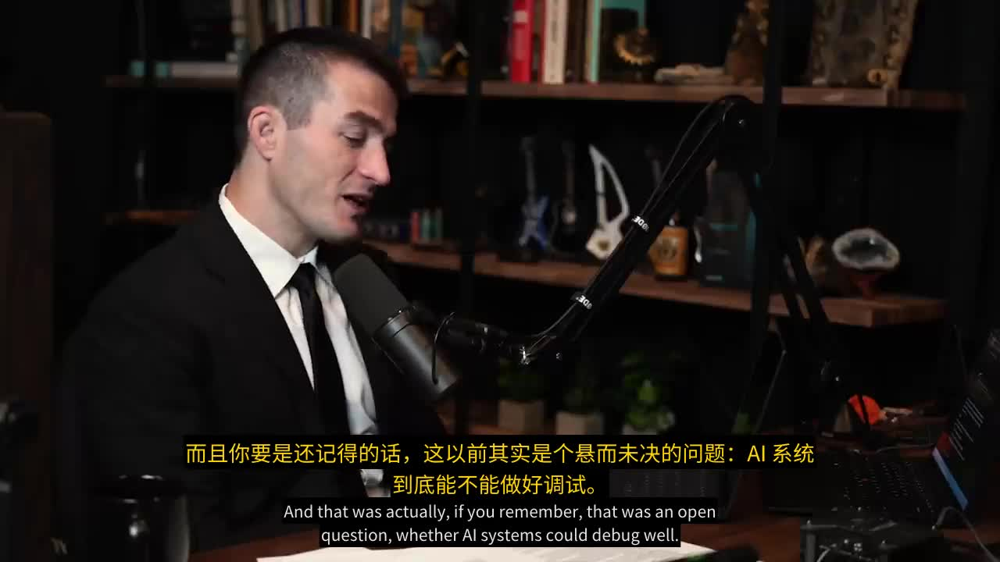

# BiliMix

BiliMix 为英文音频与视频生成中文配音，支持人物音色克隆、背景音混合和双语 ASS 字幕。

[English](README.en.md)

## 精翻配音

使用一个 Code Agent Skill：`nows-ytb-dubbing`。

流程为：视频输入 → 原声人物分析 → FULL 完整断句 → 中文精翻 → 服务端配音 → 交付。

当前 Agent 完成 FULL 和精翻；统一入口负责下载、上传、格式转换、校验、恢复和交付。BiliMix 使用已确认的人物参考合成完整话语，再按音频时间调整视频。

一个完整中文话语对应一次 TTS。默认同一人物全片使用固定参考，也可启用逐段参考并记录同人物回退；显示字幕独立分页，默认中文最多两行、英文最多两行、合计最多四行，文字高度预算为画面的 25%。

音频播客也可使用服务端转录和翻译；独立 TTS 接口支持参考音频加文本合成。精翻任务以 Agent 提交的翻译为准。

## 效果演示

[](examples/dubbing-demo.mp4)

75 秒片段：中文配音由原片人物音色合成，画面按中文音频时长等比调整，底部烧录双语字幕（中文在上、英文在下）。

## 客户端安装

客户端支持 Python 3.10+，只需 SDK；本地下载视频另需 yt-dlp 和 FFmpeg。

```text
python -m pip install ./sdk
python scripts/install_skills.py --destination <Agent技能目录>
python -m bilimix_cli --server <服务URL> auth status
```

更新 Skill 使用同一安装命令加 `--update`，安装目录只保留当前文件，并清理已退休的两个 BiliMix 旧入口。任何支持读写文件和执行命令的 Code Agent 均可读取 Skill 的 `SKILL.md`。

## 模型服务器

完整语音链路使用 Linux x86_64、Python 3.10。需要 FFmpeg 7+（libx264、libass、drawtext）、FFprobe、中文字体，以及 WhisperX、pyannote、Confucius4-TTS 模型。Demucs 用于人声/背景分离。

```text
./setup.sh
conda activate bilimix
python scripts/doctor.py --scope server
python services/web_app.py 5000
```

人物分析模型需要 Hugging Face 访问权限和 `HF_TOKEN`。服务端自动翻译使用 Ollama；Agent 精翻任务直接提交本地翻译。

配置文件、环境变量、服务部署见 [安装与配置](docs/installation.md)。

## 提交精翻任务

每个视频使用独立工作目录，按新 Skill 的 SKILL.md 操作。缺少客户端工具时先 setup；依赖安装到工作目录，不修改 Agent 环境。

```text
python <Skill>/scripts/workflow.py setup --workdir work
python <Skill>/scripts/workflow.py run --input source.mp4 --workdir work --server <服务URL>
python <Skill>/scripts/workflow.py run --workdir work
```

run 返回明确的下一步：当前 Agent 写 FULL/精翻结果、等待原任务、请用户确认人物，或交付成品。ASS 和 manifest 自动从语言结果生成，同视频一起提交；媒体哈希、源词顺序及完整覆盖由服务端校验。

```text
bmx --server <服务URL> task wait <task_id>
bmx --server <服务URL> video download --task-id <task_id> -o dubbed.mp4
bmx --server <服务URL> video download-subtitles --task-id <task_id> -o dubbed.ass
```

Web 中也可上传与分析相同的本地媒体，选择工作 ASS 和配音计划 JSON 后提交。

数据契约与时间轴见 [精翻配音协议](docs/audio-first-dubbing.md)。客户端命令见 [SDK](sdk/README.md) 和 [命令参考](sdk/docs/cli.md)。

模块职责、任务执行约束和扩展顺序见 [架构说明](docs/architecture.md)。

## 开发与发布

```text
python -m pytest tests -q
python scripts/sync_skill_layout.py --check
python scripts/release.py --output dist
```

发布目录包含完整源码、统一 Skill ZIP、SDK wheel 和校验清单。发布流程不打包用户配置、凭据、模型、任务、缓存或开发过程文件。

## License

MIT
