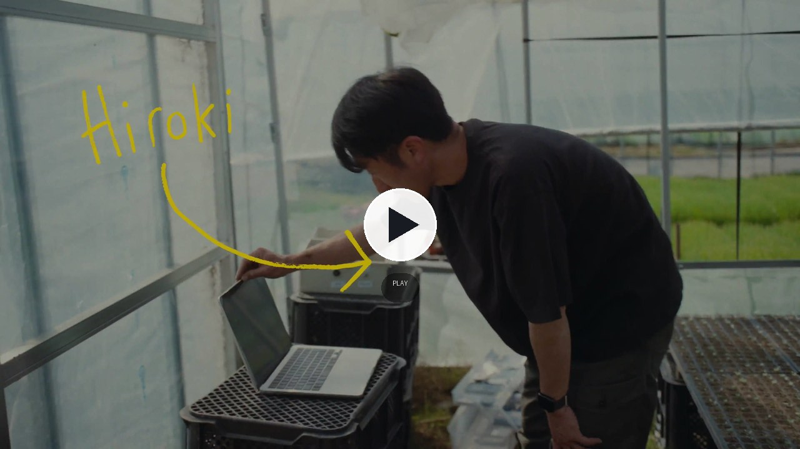
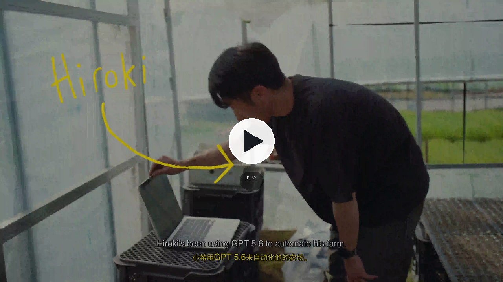

<h1 align="center">BiliMix</h1>

<p align="center"><b>英文视频 / 播客 → 原音色中文配音 + 双语字幕。</b><br>安装一个 Agent Skill，给它一个链接即可。</p>

<p align="center">
  <a href="#quick-start"></a>
  <a href="#requirements"></a>
  <a href="#requirements"></a>
  <a href="skills/nows-ytb-dubbing/SKILL.md"></a>
  <a href="#license"></a>
  <a href="https://nowszhao.github.io/BiliMix/"></a>
</p>

<p align="center">
  <a href="https://nowszhao.github.io/BiliMix/"></a>
  &nbsp;
  <a href="https://github.com/nowszhao/BiliMix/archive/refs/heads/main.zip"></a>
  &nbsp;
  <a href="#quick-start"></a>
</p>

<p align="center">
  <a href="#quick-start">Quick start</a> ·
  <a href="#gallery">Gallery</a> ·
  <a href="#what-it-makes">What it makes</a> ·
  <a href="#install">Install</a> ·
  <a href="#usage">Usage</a> ·
  <a href="#examples">Examples</a> ·
  <a href="#how-it-works">How it works</a> ·
  <a href="#requirements">Requirements</a> ·
  <a href="#limits">Limits</a>
</p>

---

BiliMix 把英文视频、播客和访谈变成中文配音，保留原说话人的音色、画面和背景音，并输出双语字幕。

你可以做视频配音、音频配音、纯字幕和独立语音合成。整个使用入口只有一个 Agent Skill：它负责下载、上传、FULL、精翻、任务推进和交付，BiliMix 服务负责人物分析、TTS、混音和成片。

[English](README.en.md)

## Quick start

### 1. 安装 Skill

把 [`skills/nows-ytb-dubbing`](skills/nows-ytb-dubbing) 装进任意支持 Skill 的 Agent。也可以使用 Release 里的 `nows-ytb-dubbing.zip`，或用 Agent 自带的 Skill 安装器安装。

这个 Skill 自带客户端 SDK wheel。第一次使用时，Agent 会在需要时运行 Skill 的 setup，把 yt-dlp、FFmpeg 工具和 SDK 安装到当前项目目录，不改 Agent 环境。

### 2. 给它一个链接

直接对 Agent 说：

```text
用 nows-ytb-dubbing 把这个视频做成中文配音：
https://www.youtube.com/watch?v=...
```

第一次使用，Agent 会检查 BiliMix 服务；如果 Agent 能访问目标机器且服务还没准备好，它会按安装文档完成服务端配置。之后每次只需要给链接。

## Gallery

左边原声，右边中文配音。点击封面播放完整视频。

<table>
  <tr>
    <td width="50%"><a href="examples/test1.mp4"></a></td>
    <td width="50%"><a href="examples/test1_mixed.mp4"></a></td>
  </tr>
  <tr>
    <td><sub><b>配音前</b>：英文原声。</sub></td>
    <td><sub><b>配音后</b>：原音色中文配音 + 双语字幕。</sub></td>
  </tr>
</table>

## What it makes

| Kind | What it is | Output |
|---|---|---|
| **视频配音** | 英文视频逐句翻译，用原说话人的音色朗读中文 | 中文配音 MP4 + 双语 ASS |
| **音频配音** | 英文播客、访谈或音频文件 | 中文配音 MP3 |
| **纯字幕** | 只做 FULL、精翻和字幕排版，不连接 BiliMix 服务端 | 双语 ASS |
| **独立 TTS** | 给一段参考音频和文本，直接合成语音 | 原音色音频文件 |

字幕默认中文在上、英文在下，每种语言最多两行，文字高度不超过画面的 25%。字幕分页独立于 TTS 断句。

## Install

### Skill

Skill 是唯一需要用户安装的入口。它包含：

- `SKILL.md`：Agent 的操作说明
- `scripts/workflow.py`：下载、上传、校验、任务推进和交付
- `assets/`：内置 SDK wheel

安装方式取决于你的 Agent：使用它的 Skill 安装器，或把 `skills/nows-ytb-dubbing` 放到它的 skills 目录。任何能读写文件、执行命令的 Agent 都可以使用。

### BiliMix 服务

BiliMix 服务负责人物分析、TTS、混音和视频组装。它可以运行在本地机器或一台可访问的机器上。

第一次使用，让 Agent 按 [安装与配置](docs/installation.md) 准备服务；如果已经有运行中的 BiliMix 地址，直接告诉 Agent 即可。

## Usage

### 第一次使用

```text
用 nows-ytb-dubbing 准备 BiliMix 服务，然后把这条视频做成中文配音：
https://www.youtube.com/watch?v=...
```

Agent 会完成环境检查、服务准备、视频上传、人物分析、FULL、精翻、TTS、混音和下载。你不需要手动运行 CLI。

### 后续使用

```text
用 nows-ytb-dubbing 把这条视频做成中文配音：
https://www.youtube.com/watch?v=...
```

如果服务已经在运行，只需要给链接。任务需要你介入时，Agent 会明确提示：

- 人物重叠或换人边界需要听审确认
- 缺少合格的同一人物参考音频
- 服务端任务失败或需要恢复

## Examples

| Example | What it shows | Open |
|---|---|---|
| `demo` | 60 秒原声与中文配音并排对比 | [demo.html](demo.html) · [MP4](examples/demo-dubbed.mp4) |
| `test1` | 较长的英文视频与完整配音版本 | [原声](examples/test1.mp4) · [配音](examples/test1_mixed.mp4) |
| `subtitle-only` | 只生成双语字幕，不连接 BiliMix 服务端 | [字幕说明](skills/nows-ytb-dubbing/references/subtitles.md) |

## How it works

1. **Agent 语言处理**：FULL 保留全部源词与顺序；精翻产出完整中文话语和稳定源词映射。
2. **BiliMix 人物与语音**：WhisperX 词级时间、人物分段、声纹复核、参考音频选择，再用 Confucius4-TTS 合成。
3. **成片**：混音后按音频时长适配画面，烧录双语字幕，返回 MP4、MP3、ASS 和参考报告。

分析和配音任务共享按媒体 SHA256 命名的音频与 Demucs 缓存。同一视频只提取一次音频、只分离一次人声。

字幕分页独立于 TTS 断句。一个完整中文话语对应一次 TTS；显示字幕可以拆成多页，但不会反过来切碎配音。

## Requirements

- **服务端**：Python 3.10–3.12，FFmpeg 7+，FFprobe，CJK 字体，WhisperX、pyannote、Demucs、Confucius4-TTS
- **客户端**：Python 3.10+，SDK；URL 下载需要 `yt-dlp` 和 FFmpeg
- **硬件**：最低 4 核 CPU、8 GB 内存、15 GB 磁盘；推荐 8 核、16 GB 以上
- **GPU**：可选，用于加速 TTS 和 WhisperX
- **人物模型**：需要 Hugging Face 授权时设置 `HF_TOKEN`

## Limits

- CPU 推理是主要瓶颈，Demucs、人物分段和 TTS 都可能占用较长时间。
- 人物分析是概率结果。重叠、换人边界和未知声线需要人工听审，不能自动猜。
- 外部精翻必须同时提供工作 ASS、manifest 和已完成的人物分析；缺少依赖会失败，不会静默回退到服务端翻译。
- 当前是单进程、单重型执行位。不要通过增加 WSGI worker 数量扩展模型并发。
- 参考音频质量直接决定克隆效果；没有合格同人参考时不会借用其他声线。

## License

MIT

<p align="center"><sub>如果 BiliMix 对你有帮助，欢迎点一个 Star，让更多人找到它。</sub></p>
