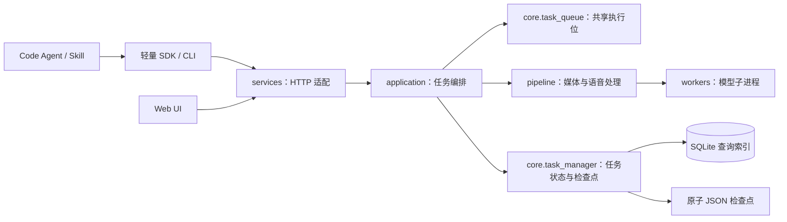

# BiliMix 架构

BiliMix 采用单进程模块化应用。HTTP、任务编排、语音算法和 Agent 语言工作分开维护。模型进程由任务执行层管理，精翻内容由 Agent 提交；字幕分页不决定配音断句。

## 模块职责

| 模块 | 职责 | 不承担 |
|---|---|---|
| `services/web_app.py` | 构建 Flask、注册路由、显式启动 | 模型处理、重试循环、后台线程自动启动 |
| `services/task_api.py` | 请求验证、任务命令、HTTP 响应 | TTS、混音、视频组装 |
| `application/task_execution.py` | 排队、来源准备、首次/恢复处理选择、异常收口 | Flask 请求与响应 |
| `application/source_analysis.py` | 可独立恢复的人物分析 | 翻译、配音 |
| `application/dubbing.py` | 完整话语配音、混音、字幕与画面适配 | HTTP、重新实现排队算法 |
| `core/task_queue.py` | 单一重型任务执行位、等待项顺序、执行权释放 | 模型细节、任务内容 |
| `core/task_manager.py` | 任务类型、状态、持久化和恢复 | 依赖 HTTP 路由 |
| `pipeline/` | 可独立测试的处理算法及媒体操作 | 导入 Flask、反向调用应用层 |
| `workers/` | 模型隔离与实际推理 | 决定任务生命周期 |
| `skills/nows-ytb-dubbing` | 完整断句、Agent 精翻、流程推进与交付 | 安装服务端模型、替服务端猜人物 |

`services` 可以调用 `application`；`application` 可以调用 `pipeline` 和 `core`。`core`、`pipeline` 不反向依赖 `services` 或 `application`。通过架构测试固定此方向。

## 执行与恢复

- 由一个共享队列执行音频、视频、人物分析、确认后的续跑、重试及独立 TTS。一个任务内仍可按配置运行多个 TTS worker。
- 队列明确区分 active 和 pending。取消 active 只发出停止信号；直到回调真正退出才释放执行位。排序和移除只作用于 pending。
- 删除运行中任务时，先请求停止并等待退出，再清理文件；退出超时返回 409，避免后台重新写入已删除目录。
- 首次处理与重做共用来源准备和主流程；断点重试和 retry-synthesis 共用恢复路径。retry-synthesis 返回 202 后按同一 task_id 查询。
- 视频分析任务与配音任务共享 `data/downloads/video_cache/_shared` 中按媒体 SHA256 命名的提取音频和 demucs 人声缓存；共享缓存不归单个任务清理，避免对同一视频重复提取音频和重复分离人声。
- `create_app()` 构建 HTTP 适配，不启动后台工作。命令行入口调用 `services.bootstrap.start_runtime()`，在数据库恢复完成后启动一份订阅刷新。
- 当前部署使用一个服务进程、多个 HTTP 线程。不能通过增加 WSGI worker 数扩展模型并发；需要多进程/多机时，应先将调度和执行权迁到持久化队列，再扩展 HTTP。

## 状态与文件

任务的媒体类型、语言话语、字幕分页和参考方式是不同概念。视频任务的音频处理结果只是中间产物，最终必须成功组装视频。

新任务从接受时就分配固定的任务目录，并保存完整输入绑定：媒体来源、分析 ID、工作 ASS、配音 manifest 和参考模式。后续准备媒体不改变任务目录。

SQLite 保存查询用摘要；`task_result.json` 保存可恢复的完整快照；模型文件、参考音频和生成媒体保存在该任务目录。关键状态先刷新快照与索引，完成后才向查询方发布该状态。恢复直接读取完整快照，不再从散落的字幕、音频和旧字段列表拼装；已有检查点损坏或任务 ID 不匹配时明确拒绝恢复。JSON 写入先完成临时文件及 fsync，再原子替换目标；失败会显式抛出，旧快照保持完整。

这仍是两种存储，尚不构成跨 SQLite/文件系统的事务。服务重启把未完成任务标为可重试错误，不自动重新提交大型任务。

## Skill 与发布

唯一维护及发布的 Skill 是 `nows-ytb-dubbing`。旧的下载/精翻/提交组合实现不再作为另一条流程保留。源码、安装包和安装目录分别承担维护、分发和使用职责。

- Agent 只改语言结果，稳定来源 ID、时间、媒体哈希、工作 ASS 与 manifest 由脚本维护。
- 提交丢响应时保留 pending_submission，不自动重发。服务器尚无原子幂等提交键，恢复必须找到唯一原任务。
- 交付包含最终参考选择报告，汇总真实逐段参考数量和同人物回退数量。不能把打开 segment 模式描述成每句都逐段复刻。
- 字幕布局的唯一源码在 `pipeline/subtitle_layout.py`。Skill 的无依赖副本由同步脚本生成，CI 和打包校验一致性。
- SDK wheel 随 Skill 分发并校验 SHA256；安装到任意 Agent 目录，不依赖作者电脑路径。发布源码必须包含 application。

## 后续演进顺序

| 优先级 | 尚需收拢的职责 | 目标 |
|---|---|---|
| 高 | 任务仍以字典及手工字段维护，HTTP 提交验证较长 | 引入明确的任务输入/检查点数据模型，集中序列化和不变量验证 |
| 高 | SQLite 索引、文件快照、提交回执尚非同一事务 | 建立持久化提交键和事务化任务记录，消除标题匹配恢复 |
| 中 | 配音模块保留较多步骤细节和状态回调 | 在同一应用接口下收拢合成计划、音频成品与视频成品，先用现有回归约束行为 |
| 中 | 每任务加载模型，模型依赖环境复杂 | 在资源隔离和取消协议明确后评估常驻推理 worker；用真实音频比较质量及吞吐 |
| 中 | 前端状态与 CLI 命令数量增长 | 围绕统一任务契约分组维护，避免各端重新推断状态与类型 |

功能迭代优先扩展既有模块的接口，只有存在真实变化维度或多处重复决策时才增加新模块。不要为每个特例新增流程、万能管理器或微服务。
