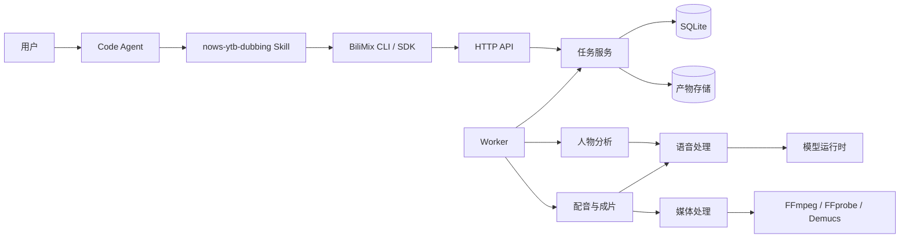
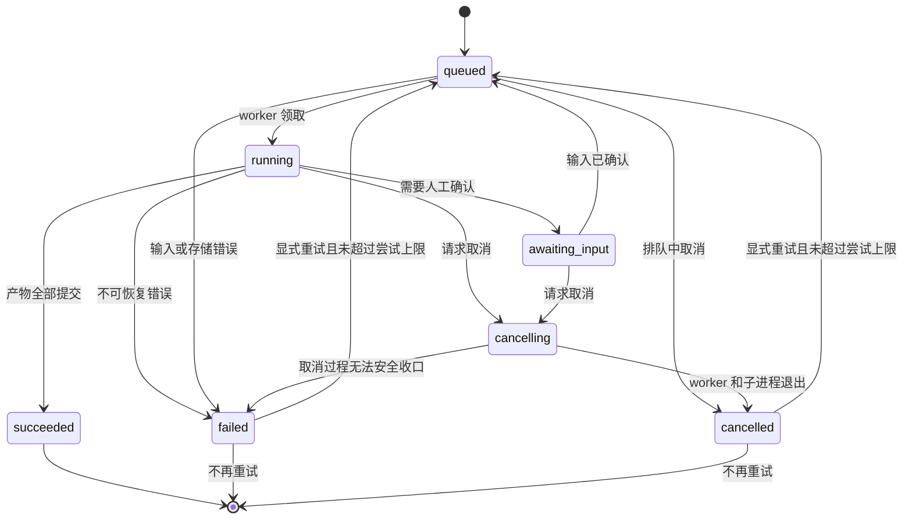

# BiliMix 架构设计

BiliMix 是一个面向 Agent 的本地配音系统。它接收英文视频或音频，基于源媒体完成人物分析、参考音频选择、完整中文话语合成、混音和视频适配，输出中文配音、双语字幕和参考选择报告。

系统由四个可独立理解的部分组成：

- `nows-ytb-dubbing` Skill：下载媒体、组织语言工作、生成精翻协议、推进任务和交付结果。
- BiliMix 客户端：通过版本化 HTTP API 上传媒体、提交任务、查询进度和下载产物。
- BiliMix 服务端：保存任务状态，执行人物分析与配音，管理模型进程和媒体产物。
- Web 控制台：通过同一 HTTP API 提交任务、听审人物、查看进度和下载产物。

语言翻译属于 Skill 或客户端。服务端不调用翻译模型，只接受已经满足协议的精翻结果。

## 设计目标

1. 一条媒体从提交到交付的路径确定、可追踪、可恢复。
2. 公开 API、任务状态、精翻协议和产物格式都有稳定契约。
3. 同一个请求重复提交不会产生多个任务。
4. 进程退出、任务取消和模型子进程退出有明确边界。
5. 媒体、人物、参考音频和显示字幕之间的绑定不会被隐式改变。
6. 默认部署可以在单机安全运行，不依赖外部消息队列或云服务。
7. 外部贡献者可以只读本文理解系统，再进入代码和模块。

## 设计原则

- 数据结构先于模块划分。先定义任务、分析、精翻、参考和产物，再决定文件和模块。
- 状态只有一个权威来源。任务状态由数据库维护，文件系统保存媒体和产物，不保存第二份可恢复任务状态。
- 重型处理只有一个执行位置。HTTP 进程不运行模型、不持有执行权。
- 控制流显式。任务状态变化通过受控转移完成，处理步骤不直接改写任务生命周期。
- 取消是协作协议。请求取消、停止工作、回收子进程、发布终态是四个不同阶段。
- 媒体内容决定身份。源媒体、参考音频、合成缓存和产物都用 SHA256 标识。
- 相同幂等键得到同一个任务。相同内容共享缓存，缓存键包含影响结果的全部参数。
- 失败显式。损坏检查点、协议不符、参考不足和产物缺失都拒绝继续，不做静默回退。
- 只抽象已有变化。当前每个能力只有一个实现，不建立通用插件市场或多层工厂。
- 单机优先。当前架构不引入微服务、分布式锁或跨机调度。

## 系统上下文



### 外部边界

| 边界 | 输入 | 输出 |
|---|---|---|
| Skill | 视频链接、本地媒体、用户选择 | 精翻结果、任务推进、交付文件 |
| HTTP API | 媒体上传、任务命令、查询 | 任务资源、事件流、产物 |
| Worker | 可执行任务 | 分析结果、音频、字幕、视频 |
| 模型运行时 | 媒体、文本、参考音频、参数 | 转写、声纹、人物分段、语音 |

Skill、客户端和服务端共享协议，不共享内部模块。

## 运行形态

BiliMix 是单机模块化系统，包含两个进程角色：

- API 进程：认证、请求校验、任务命令、查询、事件流和产物下载。
- Worker 进程：领取任务、调用媒体与模型处理、提交产物和终态。

两个角色共享同一个 SQLite 数据库和同一个产物存储目录。默认部署只有一个 Worker，并只开放一个重型执行位。API 可以多线程处理请求，但增加 WSGI worker 不会增加模型并发。

CPU 和 GPU 使用同一种任务协议。设备、模型和并发容量属于部署配置，不进入任务业务语义。

## 核心对象

### Media

`Media` 是已登记的输入文件：

| 字段 | 含义 |
|---|---|
| `media_id` | 按内容寻址的不可变 ID |
| `sha256` | 文件内容哈希 |
| `media_type` | 音频或视频 |
| `size` | 字节数 |
| `duration` | 可探测时记录的时长 |
| `original_name` | 仅供展示的原始文件名 |

`media_id` 不能指向客户端提供的任意文件系统路径。

### TaskSpec

`TaskSpec` 是任务创建时固定的输入，不允许在重试过程中修改。

| 字段 | 含义 |
|---|---|
| `kind` | `analysis` 或 `dubbing` |
| `source_media_id` | 按内容寻址的不可变媒体 ID |
| `language` | 源语言和输出语言 |
| `analysis_snapshot_id` | 配音任务绑定的不可变分析快照 |
| `manifest_id` | 按内容寻址的精翻协议 ID |
| `reference_mode` | `speaker` 或 `segment` |
| `options` | 字幕、背景音、输出格式等任务选项 |

`analysis_snapshot_id`、`manifest_id` 和 `reference_mode` 只属于配音任务。分析任务只需要源媒体、语言和处理选项。

分析任务与配音任务拥有独立身份。配音任务可以引用分析任务，但不能把分析任务改造成配音任务。

### Task

`Task` 是运行期状态，不包含语言内容的第二份副本。

| 字段 | 含义 |
|---|---|
| `task_id` | 服务端分配的任务 ID |
| `spec` | 不可变 `TaskSpec` |
| `state` | 受控任务状态 |
| `phase` | 当前处理阶段 |
| `progress` | `0..100`，只用于展示 |
| `attempt` | 当前执行次数 |
| `revision` | 状态快照版本，用于并发控制 |
| `error` | 结构化错误 |
| `created_at` / `updated_at` | 生命周期时间 |
| `started_at` / `finished_at` | 执行时间 |

`phase` 的取值为 `ingest`、`separate`、`transcribe`、`diarize`、`verify`、`references`、`synthesize`、`mix`、`subtitle`、`render` 或 `publish`。`phase` 只描述进度，不能替代 `state`。

### TaskEvent

`TaskEvent` 是任务状态的追加记录：

- 每个任务有单调递增的事件序号。
- 事件包含时间、转移前状态、转移后状态、阶段、错误码和公开消息。
- 事件与状态变化在同一个数据库事务中提交。
- 事件流、诊断和恢复审计读取同一份事件记录。

### Analysis

`Analysis` 是源媒体人物分析的完整结果：

- `analysis_id` 表示人物分析对象，`revision` 和 `snapshot_id` 表示不可变快照。
- 媒体 SHA256 和媒体时长。
- 词级转写、原生人物分段和重叠区间。
- 声纹复核后的人物归属。
- 未知、冲突和需要人工确认的词。
- 每个人物的合格参考区间。
- `dubbing_ready` 与阻塞原因。

人工听审生成新的分析 revision，不修改已有快照。配音任务绑定一个明确的 `analysis_snapshot_id`。

### DubManifest

`DubManifest` 绑定源分析与完整中文话语：

- `analysis_snapshot_id` 和源媒体 SHA256。
- 每个完整话语的唯一 `unit_id`。
- 人物、完整英文话语和完整中文话语。
- 按源顺序完整覆盖的 `source_word_ids`。
- 话语边界和可选显示字幕分页。

字幕分页不改变配音话语。一个完整中文话语对应一次 TTS 请求，显示字幕可以拆成多页。

### ReferenceReport

`ReferenceReport` 记录每个配音话语实际使用的参考：

- `unit_id`、人物和请求模式。
- 实际模式、参考起止时间和参考 SHA256。
- 是否因最长参考限制而截取。
- 同人物固定参考的回退原因。
- 实际逐段参考数和回退数汇总。

### Artifact

`Artifact` 表示可下载或可复用的文件：

| 字段 | 含义 |
|---|---|
| `artifact_id` | 产物 ID |
| `sha256` | 文件内容哈希 |
| `media_type` | 音频、视频、字幕、JSON、诊断包 |
| `size` | 字节数 |
| `source` | 上传、分析、合成、成片、缓存 |
| `state` | `pending`、`committed`、`deleted` |
| `created_at` | 提交时间 |

任务结果只引用已提交产物。未提交临时文件不进入任务结果，也不对外提供下载。

### Problem

所有公开错误使用稳定结构：

| 字段 | 含义 |
|---|---|
| `type` | 错误类别 URI |
| `code` | 稳定机器码，如 `manifest_source_word_mismatch` |
| `title` | 简短说明 |
| `detail` | 面向人的细节 |
| `retryable` | 是否可通过重试恢复 |
| `task_id` / `phase` | 相关任务上下文 |
| `request_id` | 请求追踪 ID |

公开错误不包含凭据、绝对路径、模型提示词或未脱敏日志。

## 任务状态机



### 状态规则

- `state` 只允许通过任务状态机转移。
- `phase` 描述当前执行位置，不参与生命周期判断。
- `queued → running` 必须获得有效租约。
- Worker 必须持续续租并发送心跳。
- `cancelling` 不是终态。只有任务的所有子进程退出、执行位释放后，才能进入 `cancelled`。
- `succeeded` 之前必须完成产物清单提交和哈希校验。
- `failed` 必须包含结构化错误和最后完成阶段。
- `succeeded` 是不可重入最终态。
- `failed` 和 `cancelled` 只能通过显式重试回到 `queued`，并增加 `attempt`。
- 重试超过尝试上限后保持失败或取消状态。
- `awaiting_input → queued` 是人工输入恢复，不消耗失败重试额度。
- 重做使用相同 `TaskSpec` 创建新的派生任务。

## 提交与幂等

创建任务的 API 必须携带 `Idempotency-Key`。

- 同一个 key 和同一请求体返回原任务，不重新执行。
- 同一个 key 和不同请求体返回 `409 idempotency_key_conflict`。
- 幂等记录与任务生命周期绑定，不因任务查询或重试消失。
- 提交成功后先持久化 `queued` 任务，再返回 `201` 或 `202`。
- 响应丢失后，客户端使用原 key 重试即可找到原任务。

任务输入使用内容哈希校验。源媒体、分析快照、manifest 和参考模式必须同时一致。精翻协议不匹配时拒绝提交，不自动放宽。

## 服务端处理链路

### 人物分析

```text
媒体登记
  → 提取音频
  → 人声与背景分离
  → 词级转写
  → 原生人物分段
  → 声纹复核
  → 人工确认
  → 参考音频选择
  → Analysis 产物
```

分析任务不进入翻译、TTS、混音或视频组装。`dubbing_ready` 为 false 时任务进入 `awaiting_input`。人工听审生成新的分析 revision，并把同一分析任务重新排队；不重新下载媒体或重做已完成的转写。

### 配音

```text
媒体与分析绑定校验
  → DubManifest 校验
  → 完整话语规划
  → 参考音频选择
  → TTS 合成
  → 句间规划与混音
  → 字幕排版
  → 视频帧适配
  → 主音频与视频封装
  → 产物提交
```

配音只使用已提交的分析。分析能力或参考资格不足时停止，不借用其他人物声线。

### 分析任务与配音任务

- 分析任务输出 `Analysis`、源音频和参考池。
- 配音任务输出中文音频、最终字幕、可选视频和参考报告。
- 两个任务按源媒体 SHA256 共享提取音频、Demucs 人声和可复用参考池。
- 共享缓存由产物引用计数管理，不归单个任务直接删除。

## 人物与参考音频

人物归属是概率结果，必须保留证据和不确定性。

- 每个源词有稳定 ID、起止时间、原生人物、复核人物和验证状态。
- 声纹复核只修正达到难度门槛的词。
- 未知、重叠、跨人物和证据不足的词进入人工确认。
- 人工确认与声学复核分别记录，不伪装成自动结果。
- 每个参考区间必须属于同一人物、连续、可提取、无明显重叠和严重削波。
- 固定参考必须达到连续语音的资格门槛，最长 10 秒。
- `segment` 模式按每个完整配音话语的源词范围选择参考。
- `segment` 参考不合格时回退同人物固定参考，并记录 `fallback_reason`。
- 没有同人物合格参考时停止合成。

产物必须包含实际参考模式、参考区间、参考 SHA256、是否限长和回退原因。打开 `segment` 模式不等于每一句都使用逐段参考。

## 音频与视频

中文音频是主时间轴。视频适配音频，音频不反向适配视频。

- 每个完整中文话语对应一个输出 WAV，合成结果按文本、参考、语种、模型和参数缓存。`pipeline/tts_narration.py` 负责中文标点分段、可复现候选采样协议、声学节奏检查和音频/质量报告的原子提交；Worker 只负责加载模型、设置随机种子并执行推理。
- 中文长话语内部只在标点处规划模型片段，不按字幕分页或字数硬切；片段保持同一参考且不叠加发音。无自然标点的超长从句要求先修正文本。
- 完整话语模式按延续、句末和轮次结束补足 100/220/300ms 的间隙；先整理首尾静音并扣除已有停顿。旧 segment 输入仍按原时间关系计算间隙。任何模式均不拉伸语音。
- Confucius 合成最多尝试三次候选；极端语速、异常长句内静音、严重削波和无效波形不得发布。纯中文短句按累计有声时长筛出明显拖音，较长中文片段按整体发声跨度估算语速。结果保留每个候选的指标、种子、选择及警示，详细阈值见 `docs/audio-first-dubbing.md`。
- 克隆参考分离失败时停止，不使用可能包含音乐的原始混音。默认只输出配音人声；`keep_bgm=false` 时忽略任何缓存背景轨。既有部署设置仍可覆盖新任务的默认背景音选项。
- 合成缓存指纹包含引擎和策略源码；WAV 与质量报告按 SHA256 绑定。WAV 在报告写入后原子提交，只有完整匹配的音频才可复用，损坏缓存显式报错。
- 配置 `BILIMIX_PACED_ZH_ROOT` 后，固定参考中文由 `workers/paced_mandarin_worker.py` 执行 Melo 音素时长预测、生成帧数约束及 OpenVoice V2 音色转换。完整中文按自然标点处理，音色转换沿用导读帧时间轴。每段只生成一次，产物保留实际音素时长、约束次数、转换前后时长与生成耗时。同批次按参考内容哈希复用音色特征。其他语言及逐段参考交由 Confucius。两种后端共用执行队列和子进程监督，资源缺失显式失败。
- 混音保留一份连续主音频。
- 视频分块只承担编码和画面适配，最终封装必须使用同一份主音频。
- 源视频间隙不足时补停帧，不通过删减中文内容或异常加速解决。
- 最终导出检查视频帧数、音频时长、字幕起止和容器可解码性。

### 字幕

- 中文和英文分别分页。
- 每种语言最多两行，合计最多四行。
- 字幕文字高度不超过画面高度的 25%。
- 分页保持连续，不改变整体起止。
- 布局按实际视频宽高和字号计算，并输出布局摘要。
- 最终字幕使用配音后的时间轴，工作 ASS 只用于导入和审校。

## 存储

### 权威关系

- SQLite 是任务状态、任务事件、执行租约、幂等键和产物元数据的唯一权威。
- 文件系统保存上传媒体、中间缓存和已提交产物。
- `task_result.json` 只是调试或导出快照，不参与任务恢复。
- 内存只保存请求级缓存，不作为跨请求状态来源。

### SQLite

数据库启用 WAL、外键和显式事务。核心表包括：

- `tasks`
- `task_events`
- `job_leases`
- `idempotency_keys`
- `artifacts`
- `artifact_refs`
- `media`
- `analyses`
- `analysis_revisions`

状态变化和对应事件在同一个事务内提交。查询接口读取已提交 revision。

### 产物提交

文件先写入同文件系统的临时位置，完成 flush 和 fsync 后重命名为内容哈希路径，再提交产物元数据。只有元数据为 `committed` 的文件可以出现在任务结果中。

任务进入 `succeeded` 前必须满足：

1. 所有必需产物存在。
2. 每个产物哈希和大小匹配。
3. 任务结果清单已持久化。
4. 任务引用已指向已提交产物。

### 缓存与清理

- 上传媒体、提取音频、Demucs 人声、参考音频和 TTS 音频均按内容寻址。
- 缓存键包含对结果有影响的内容哈希和参数。
- 删除任务只删除任务引用和任务独占产物。
- 共享产物由引用计数管理。
- 清理过程可重入，进程中断后可以继续。
- 存储配额和使用量通过诊断接口公开，不静默删除仍在引用的内容。

## 调度、并发与取消

### 调度

- Worker 从 SQLite 领取 `queued` 任务。
- 领取在事务中完成，并写入 worker ID、租约和心跳。
- 默认只有一个重型执行位。
- 队列顺序和任务优先级属于调度属性，不写入业务处理模块。
- 任务被领取后，HTTP 请求不能持有或释放执行权。
- Worker 优雅退出时停止领取新任务，等待当前任务安全收口。

### 租约恢复

- 租约过期且 Worker 心跳停止后，任务可以被重新领取。
- 恢复前检查输入绑定和已提交产物。
- 可安全恢复的处理步骤继续执行；检查点损坏或哈希不符时任务失败。
- 尝试次数超过部署上限后进入 `failed`，不再无限重领。

### 取消

1. API 写入取消请求并返回 `202`。
2. 任务进入 `cancelling`。
3. Worker 收到取消令牌。
4. 处理步骤停止启动新的模型子进程。
5. Worker 终止并回收当前进程组。
6. 执行位释放。
7. 任务进入 `cancelled`。

删除运行中的任务执行同一取消协议。删除接口只有在任务退出后才清理任务引用和独占产物；超时返回可重试错误。

## HTTP API

公开 API 只使用一个版本前缀：`/api/v1`。

### 资源

| 资源 | 作用 |
|---|---|
| `POST /media` | 创建上传媒体并获得 `media_id` |
| `POST /tasks` | 提交分析或配音任务 |
| `GET /tasks` | 查询任务列表 |
| `GET /tasks/{id}` | 查询任务状态和最近事件 |
| `GET /tasks/{id}/events` | 订阅任务事件流 |
| `POST /tasks/{id}/cancel` | 请求取消 |
| `POST /tasks/{id}/retry` | 恢复同一任务 |
| `POST /tasks/{id}/redo` | 从同一输入创建新任务 |
| `DELETE /tasks/{id}` | 取消并删除任务 |
| `POST /analyses/{id}/review` | 提交人物确认 |
| `GET /artifacts/{id}` | 下载已提交产物 |
| `GET /health` | 进程存活检查 |
| `GET /ready` | 数据库、存储和模型能力检查 |

### API 规则

- 请求和响应由 OpenAPI 3.1 定义。
- 上传媒体按内容寻址，相同字节返回同一个 `media_id`。
- 错误响应使用 `Problem`，所有错误都有稳定 `code`。
- 任务状态响应包含 `revision`，并发写命令通过 revision 或状态前置条件防止竞争。
- 事件流使用 Server-Sent Events，断线后可以按事件游标继续。
- 产物下载必须经过授权，不使用可猜测的任意文件路径。
- API 不接受客户端提供的服务端绝对路径。
- 服务端不提供翻译、播客订阅、通用文件浏览或任意配置读写接口。

## 客户端与 Skill

### 客户端

客户端负责：

- 上传媒体并保存 `media_id`。
- 携带幂等键提交任务。
- 查询状态、消费事件和下载产物。
- 在本地保存服务器地址、会话和未完成提交记录。
- 把公开错误转换为稳定退出码和机器可读输出。

客户端不使用服务端内部字段，不根据状态文本推断行为。

### Skill

Skill 负责：

- 下载输入媒体。
- 指挥当前 Agent 完成 FULL 和精翻。
- 校验源词覆盖、人物边界和字幕分页。
- 生成 `DubManifest`。
- 通过客户端提交、恢复和交付任务。

Skill 不保存密码、Token 或服务器凭据。一个项目目录保存项目状态、分析快照、语言结果和交付索引。项目恢复必须复用原任务和原输入绑定。

## 配置

配置在进程启动时加载为一组不可变 `Settings`：

1. 内置默认值。
2. 部署配置文件。
3. 环境变量覆盖。

规则：

- 配置加载没有目录创建、网络访问或后台线程副作用。
- 凭据只来自环境变量或权限受限的密钥文件。
- 模型路径、设备、并发、存储上限和公共地址属于部署配置。
- 字幕、背景音、参考模式等属于任务选项。
- Web 页面不修改部署配置。
- 不支持通过 URL、数据库或源码运行时修改任意 Python 全局变量。

## 安全与隐私

### 默认安全姿态

- 默认只监听回环地址。
- 非回环监听必须启用认证。
- 支持本地访问令牌；需要多用户时使用标准 OIDC。
- Cookie 会话启用 CSRF 防护。
- 所有写接口都经过授权和速率限制。
- 生产环境拒绝固定默认密钥。

### 媒体输入

- 上传使用流式写入、大小上限、扩展名和内容探测。
- 客户端只提交 `media_id`，不能提交服务端绝对路径。
- 远程 URL 只允许 HTTP/HTTPS。
- 远程获取校验 DNS 结果、私网地址、重定向、响应大小和超时，防止 SSRF。
- FFmpeg 和模型子进程在明确的工作目录、环境和超时下运行。

### 产物访问

- 产物按任务授权，不按文件系统路径授权。
- 下载响应设置 `Content-Disposition` 和安全 MIME。
- 临时上传和未提交产物不对外可见。
- 删除任务时撤销其产物访问权。

### 声音数据

声音克隆涉及可识别的生物特征数据。部署者必须明确告知：

- 输入媒体和参考音频会保存在本机数据目录。
- 生成语音可能被误认为原说话人。
- 使用者需要取得必要授权，并遵守来源平台和版权要求。
- 数据保留期限和删除方式由部署策略确定。

服务端不默认上传媒体、声纹结果、提示词或使用统计到外部服务。

## 可观测性

### 日志

日志使用结构化 JSON，至少包含：

- `timestamp`
- `level`
- `event`
- `request_id`
- `task_id`
- `attempt`
- `phase`
- `worker_id`
- `duration_ms`
- `error_code`

日志不记录媒体内容、参考音频、用户密码、令牌和完整模型提示词。

### 指标

至少提供：

- API 请求数、错误数和延迟。
- 队列长度、任务等待时间和执行时间。
- 各阶段成功、失败和取消次数。
- 任务尝试次数和租约过期次数。
- 模型进程启动次数、超时次数和峰值内存。
- 存储配额、已用空间和垃圾回收结果。

### 诊断

`GET /ready` 检查数据库、产物目录、FFmpeg、模型运行时和必要模型权重。诊断命令只报告能力，不下载模型、不提交任务、不输出凭据。

任务失败时生成脱敏诊断包，包含阶段、错误码、能力报告和事件摘要，不包含源媒体和模型权重。

## 故障与恢复

### API 进程退出

- 已提交事务保留。
- 未完成上传标记为未提交并进入清理流程。
- Worker 继续执行已领取任务。

### Worker 进程退出

- 当前活动任务租约到期后进入恢复流程。
- 已提交产物可复用。
- 未提交临时文件由清理流程删除。
- 模型子进程由进程组回收。

### 数据库损坏

- 启动检查失败时拒绝进入 ready。
- 不把损坏数据库当作空数据库继续运行。
- 提供备份和恢复流程；恢复前校验任务、产物和哈希。

### 产物缺失或损坏

- 恢复时逐项校验任务引用的产物。
- 可重新生成且输入完整的产物重新生成。
- 无法验证源或分析绑定时任务失败，不输出伪成功结果。

## 模型运行时

每类能力有明确调用边界：

- 转写
- 人物分段
- 声纹验证
- 人声分离
- 语音合成
- 音频测量与混音
- 视频编码与字幕渲染

模型运行时清单记录：

- 模型或运行时 ID。
- 版本或权重哈希。
- 设备要求。
- 输入输出能力。
- 许可证。
- 可复现配置。

每个能力使用一个明确实现。只有出现第二个真实实现时，才引入抽象接口。模型运行时不改写任务状态，只返回结构化结果或抛出带错误码的异常。

## 测试与验收

### 必测范围

- 状态机所有合法和非法转移。
- 幂等提交和重复响应。
- 租约过期、Worker 崩溃和恢复。
- 取消、删除和模型子进程回收。
- 数据库事务失败和产物提交失败。
- 源词覆盖、人物边界和参考模式。
- 路径穿越、SSRF、上传限制和未授权访问。
- 字幕分页、排版预算和音视频时长一致性。

### 测试层级

| 层级 | 内容 |
|---|---|
| 单元测试 | 数据模型、校验器、状态机、缓存键、字幕布局 |
| 契约测试 | OpenAPI、Problem、Manifest、客户端与当前协议一致 |
| 集成测试 | API、SQLite、产物存储、Worker 生命周期 |
| 媒体金样 | 固定短片、双人物、重叠语音、参考不足、长话语 |
| 端到端测试 | 上传到成片交付、取消后重试、重启恢复 |
| 安全测试 | 认证、授权、SSRF、路径穿越、资源上限 |
| 模型冒烟 | CPU 与 GPU 上各跑一次最小真实推理 |

### 质量基线

发布前记录并比较：

- 转写和人物归属质量。
- 参考音频实际模式与回退数量。
- 字幕溢出和分页错误。
- 音视频时长漂移。
- 单任务耗时、实时率和峰值内存。
- 队列等待和执行稳定性。

## 部署

参考部署环境为 Linux x86_64。服务端固定一个经过验证的 Python 版本，并提供 CPU 和 GPU 容器。

持久化卷：

- SQLite 数据库目录。
- 媒体与产物目录。
- 模型缓存目录。

默认部署：

- 一个 API 进程。
- 一个 Worker 进程。
- 一个重型执行位。
- 回环地址。
- 显式认证后才能远程访问。

水平扩展不属于当前架构目标。需要多机时，先替换调度与存储实现，不通过增加 API 进程模拟并发。

## 非目标

- 不是通用媒体下载器。
- 不是播客订阅或媒体库产品。
- 不是服务端翻译平台。
- 不是通用 TTS 托管服务。
- 不是插件市场或多模型编排平台。
- 不支持多机分布式调度。

## 架构约束

- HTTP 适配不执行模型推理。
- Worker 不处理 HTTP 请求。
- 语言翻译不进入服务端任务。
- 任务状态只能由任务服务修改。
- 语音和媒体处理不直接修改全局任务状态。
- 产物路径不能由客户端控制。
- 成功任务只能引用已提交产物。
- 取消活动任务不能提前释放执行位。
- 公开错误必须使用稳定错误码。
- 文档、OpenAPI 和客户端只描述当前发布协议。
